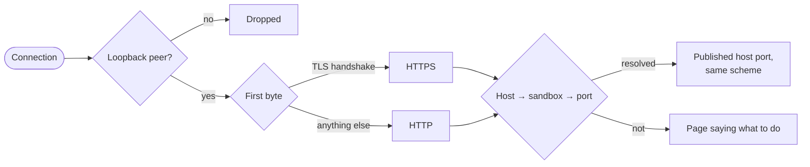

# Architecture

## One process

`makak start` runs a single Node process. It owns the Panel's HTTPS server and the reverse proxy listeners, and will own the MCP proxy. The web app inside it is SvelteKit.

| Directory | What lives there |
| --- | --- |
| `src/cli/` | The `makak` command. Loads config, starts the server, opens the browser. |
| `src/server/` | Host-side code: config, request checks, auth, the HTTPS server, the sandbox list and the Panel's own state. Plain Node and TypeScript, no Vite. |
| `src/server/proxy/` | The reverse proxy. |
| `src/server/tools/` | The only code that spawns processes: `sbx`, `git`, the browser. |
| `src/routes/`, `src/lib/` | The SvelteKit app. Pure helpers in `src/lib/` that the server needs too, such as how the proxy maps addresses, are imported from there. |

Code in `src/server/` and `src/cli/` runs directly on Node's built-in type stripping, so it uses relative imports with `.ts` extensions and only erasable TypeScript syntax (no enums, no parameter properties; `erasableSyntaxOnly` enforces it). SvelteKit code imports it as `#server/...`.

## Request pipeline

Every request passes the same gate before SvelteKit sees it, in production and in dev alike:

- **Loopback peer.** The server binds `127.0.0.1`, so other machines can't connect at all. Connections from other peers are dropped anyway, before TLS, which matters for listeners that must bind a wildcard address.
- **Host.** Must be exactly the configured hostname and port. This defeats DNS rebinding, where a foreign page makes its own hostname resolve to `127.0.0.1`.
- **Origin.** Required, and must be exactly the Panel's origin, for every method except `GET` and `HEAD`, and for every WebSocket handshake. This defeats CSRF. It follows that **`GET` and `HEAD` must never change state.**
- **Session.** Everything except the login link needs a valid session cookie.

The checks are pure functions in `src/server/security.ts`; the wiring is in `src/server/panel.ts`.

## Auth

1. `makak start` issues a login token: 32 random bytes, single-use, valid for 60 seconds.
2. It opens `https://makakctl.test:7443/_makak/login?token=…` in the browser.
3. The Panel exchanges the token for a session, sets the cookie and redirects to `/`, so the token leaves the address bar. Responses send `Referrer-Policy: no-referrer`, so it never leaks via `Referer` either.

The cookie is `__Host-makak-session` with `HttpOnly; Secure; SameSite=Strict; Path=/`. The `__Host-` prefix makes the browser enforce host-only scope. `SameSite=Strict` keeps it off requests started by other sites, including the sandboxes' own pages.

That includes links to the Panel, such as the one on every proxy error page. A cross-site navigation without a session gets a page that reloads itself instead of the 401; the reload starts on the Panel's own origin, so the browser sends the cookie. It reads nothing and changes nothing, and a reload that still has no session gets the 401. A short-lived `SameSite=Lax` marker cookie makes sure the page reloads only once, even in a browser that would treat the reload as cross-site too.

Tokens and sessions are kept in memory, hashed. Restarting the Panel signs every browser out; `makak start` signs the current one back in.

The login URL is passed to `open` on the command line, so other users of the same machine could see it in the process list. It works once, within a minute, and a stolen one shows up as an invalid link in your browser. The Panel assumes a single-user machine; it does not defend against other local users.

### Why not localhost

Cookies ignore ports. A cookie for `localhost` would be sent to `localhost:<any port>`, including a sandbox's published port, where the agent's dev server could log it. The Panel's hostname is used for nothing else, and is required to be on a different domain than the sandbox suffixes (see [configuration](configuration.md#validation)).

## Dev mode

`makak start --dev` (`pnpm dev`) runs Vite in middleware mode inside the same process, instead of loading the production build. Vite's hot-reload WebSocket is attached to an HTTP server that never listens; the Panel server hands it upgrades only after they pass the gate. So dev behaves like production, and the checks are exercised every day.

## Sharing state with SvelteKit

SvelteKit's server code is bundled separately (or, in dev, loaded by Vite), so it gets its own copy of every module, including `src/server/`. Module-level state is therefore not shared. The one shared object is `globalThis`: `makak start` puts a `PanelContext` there (`src/server/context.ts`), with the config and the tool adapters, and routes read it with `getPanelContext()`. For the same reason, routes can't recognize errors from those objects with `instanceof`; they check the error's `name` instead.

## Sandboxes and Panel state

The sandbox list comes from `sbx ls --json`, which includes the published ports. Its format is undocumented, so the parser (`src/server/tools/sbx.ts`) requires only the name, id and status, and ignores fields it doesn't know. A listing is shared by concurrent requests and reused for two seconds, because every open tab polls it every five.

What the Panel knows that `sbx` doesn't, such as notes, lives in `<stateDir>/sandboxes.json`, keyed by sandbox id rather than name: a name can be reused by an unrelated sandbox after `sbx rm`. The file is written whole, through a rename, and never overwritten when it can't be parsed.

## Reverse proxy

Each entry in `proxy.listeners` is one listener: a TCP server that gives every sandbox a stable address on that port, such as `https://feature-a.makak.test/`. The Panel lists each sandbox's addresses on its page.

- **Loopback only.** Listeners below port 1024 bind the wildcard address, because that is the only way macOS lets a normal user bind them; every listener drops non-loopback peers before reading a byte.
- **The scheme is passed through.** The first byte tells TLS from plain HTTP. TLS is terminated with the proxy's certificate, and the upstream is dialled over HTTPS without verifying its certificate; plain HTTP stays plain. The proxy never adds or removes TLS, so an `https://` address needs a server that speaks HTTPS, and the error page says so.
- **Routing.** The `Host` header is matched against the suffixes, longest first, and the label left over names the sandbox, ignoring case. Its port is the first of the listener's `upstream` candidates that the sandbox publishes over TCP, read from `sbx ls --json` through the same shared listing the Panel uses. To keep pages from stalling on `sbx`, the proxy answers from the previous listing, up to 30 seconds old, while a new one runs. A connection error drops the listing, since ports move when a sandbox is recreated.
- **Pass-through.** `Host` is kept, `X-Forwarded-For`, `-Host` and `-Proto` are set, hop-by-hop headers are dropped, and `Strict-Transport-Security` is removed from every response: with `includeSubDomains`, one sandbox could otherwise force HTTPS on every sandbox hostname, and browsers remember it. WebSocket upgrades are tunnelled to the same upstream.
- **Error pages** name the problem, show the command that fixes it, and link to the sandbox in the Panel. The proxy has no index page; the Panel replaces it.

The proxy serves sandbox hostnames only. It never sees the Panel's cookie, which is host-only and on another domain, and the Panel's hostname is required to be outside the sandbox suffixes.

## Tool adapters

All host commands go through `src/server/tools/`. Commands are spawned with argument arrays and never through a shell, so sandbox and branch names are never interpreted. Each tool has a fake, selected with `makak start --fake`, so the Panel runs and tests pass without `sbx`.
