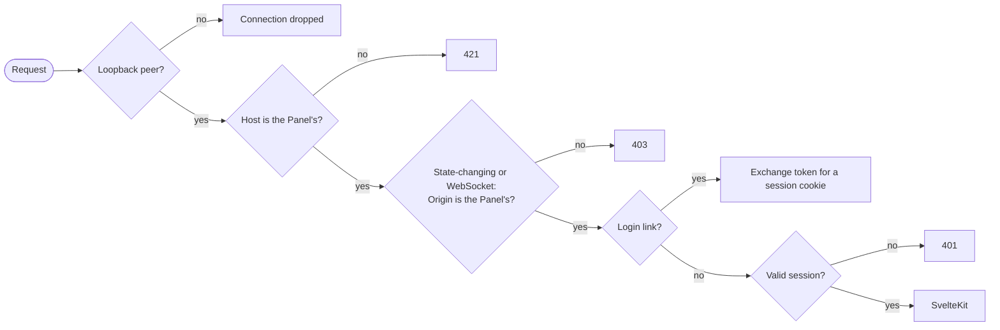
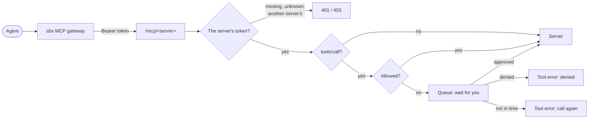

# Architecture

## One process

`makak start` runs a single Node process. It owns the Panel's HTTPS server, the reverse proxy listeners and the MCP approval proxy. The web app inside it is SvelteKit.

| Directory | What lives there |
| --- | --- |
| `src/cli/` | The `makak` command. Loads config, starts the server, opens the browser. |
| `src/server/` | Host-side code: config, request checks, auth, the HTTPS server, the sandbox list and the Panel's own state. Plain Node and TypeScript, no Vite. |
| `src/server/proxy/` | The reverse proxy. |
| `src/server/mcp/` | The MCP approval proxy, its queue, audit log and tokens. |
| `src/server/tools/` | The only code that spawns processes: `sbx`, `git`, the browser. |
| `src/routes/`, `src/lib/` | The SvelteKit app. Pure helpers in `src/lib/` that the server needs too, such as how the proxy maps addresses, are imported from there. |

Code in `src/server/` and `src/cli/` runs directly on Node's built-in type stripping, so it uses relative imports with `.ts` extensions and only erasable TypeScript syntax (no enums, no parameter properties; `erasableSyntaxOnly` enforces it). SvelteKit code imports it as `#server/...`.

## Request pipeline

Every request passes the same gate before SvelteKit sees it, in production and in dev alike:

- **Loopback peer.** The server binds `127.0.0.1`, so other machines can't connect at all. Connections from other peers are dropped anyway, before TLS, which matters for listeners that must bind a wildcard address.
- **Host.** Must be exactly the configured hostname and port. This defeats DNS rebinding, where a foreign page makes its own hostname resolve to `127.0.0.1`.
- **Origin.** Required, and must be exactly the Panel's origin, for every method except `GET` and `HEAD`, and for every WebSocket handshake. This defeats CSRF. It follows that **`GET` and `HEAD` must never change state.**
- **Session.** Everything except the login link needs a valid session cookie.
- **Except the MCP endpoints.** Paths under `/mcp/` take a bearer token instead of the cookie, and never read the cookie; see [MCP proxy](#mcp-proxy). The sbx gateway calls them, and it is no browser: it sends no `Origin`. A browser always does, so a request with any `Origin` but the Panel's is refused there too. No page of the Panel may live under `/mcp/`, since its data requests would go to the proxy.

The checks are pure functions in `src/server/security.ts`; the wiring is in `src/server/panel.ts`.

## Auth

1. `makak start` issues a login token: 32 random bytes, single-use, valid for 60 seconds.
2. It opens `https://makakctl.test:7443/_makak/login?token=…` in the browser.
3. The Panel exchanges the token for a session, sets the cookie and redirects to `/`, so the token leaves the address bar. Responses send `Referrer-Policy: no-referrer`, so it never leaks via `Referer` either.

The cookie is `__Host-makak-session` with `HttpOnly; Secure; SameSite=Strict; Path=/`. The `__Host-` prefix makes the browser enforce host-only scope. `SameSite=Strict` keeps it off requests started by other sites, including the sandboxes' own pages.

That includes links to the Panel, such as the one on every proxy error page. A cross-site navigation without a session gets a page that reloads itself instead of the 401; the reload starts on the Panel's own origin, so the browser sends the cookie. It reads nothing and changes nothing, and a reload that still has no session gets the 401. A short-lived `SameSite=Lax` marker cookie makes sure the page reloads only once, even in a browser that would treat the reload as cross-site too.

Tokens and sessions are kept in memory, hashed. Restarting the Panel signs every browser out; `makak start` signs the current one back in.

The login URL is passed to `open` on the command line, so other users of the same machine could see it in the process list. It works once, within a minute, and a stolen one shows up as an invalid link in your browser. The Panel assumes a single-user machine; it does not defend against other local users.

### Why not localhost

Cookies ignore ports. A cookie for `localhost` would be sent to `localhost:<any port>`, including a sandbox's published port, where the agent's dev server could log it. The Panel's hostname is used for nothing else, and is required to be on a different domain than the sandbox suffixes (see [configuration](configuration.md#validation)).

## Dev mode

`makak start --dev` (`pnpm dev`) runs Vite in middleware mode inside the same process, instead of loading the production build. Vite's hot-reload WebSocket is attached to an HTTP server that never listens; the Panel server hands it upgrades only after they pass the gate. So dev behaves like production, and the checks are exercised every day.

## Sharing state with SvelteKit

SvelteKit's server code is bundled separately (or, in dev, loaded by Vite), so it gets its own copy of every module, including `src/server/`. Module-level state is therefore not shared. The one shared object is `globalThis`: `makak start` puts a `PanelContext` there (`src/server/context.ts`), with the config and the tool adapters, and routes read it with `getPanelContext()`. For the same reason, routes can't recognize errors from those objects with `instanceof`; they check the error's `name` instead.

## Sandboxes and Panel state

The sandbox list comes from `sbx ls --json`, which includes the published ports. Its format is undocumented, so the parser (`src/server/tools/sbx.ts`) requires only the name, id and status, and ignores fields it doesn't know. A listing is shared by concurrent requests and reused for two seconds, because every open tab polls it every five. The sidebar sorts it in the browser, newest first unless another order is chosen there; the choice is remembered in that browser only.

What the Panel knows that `sbx` doesn't, such as notes and how it created a sandbox, lives in `<stateDir>/sandboxes.json`, keyed by sandbox id rather than name: a name can be reused by an unrelated sandbox after `sbx rm`. The file is written whole, through a rename, and never overwritten when it can't be parsed.

## Sandbox lifecycle

`src/server/lifecycle.ts` creates, starts, stops and removes sandboxes; `src/server/envs.ts` reads the env directory. How it looks to the user is in [env files](env-files.md).

- **Plan, then apply.** Every change that applies env files runs `sbx env plan` first and shows it. The approval carries a SHA-256 hash of each file as planned, and the Panel refuses to apply, with `--force`, files that no longer match. The plan is not kept on the server: the form carries the request and the hashes, and the server checks everything again on apply.
- **The record.** After `sbx env run` creates a sandbox, the Panel looks up its id and records the absolute file paths and args under it. A sandbox `sbx` created before failing is recorded too, so it can be removed with its env. A managed sandbox's record outlives it, so it can be created again; _Forget_ deletes the record. Removing an unmanaged sandbox deletes its notes, and the confirmation lists them.
- **Identity.** Every action names the sandbox's id as the page saw it, and is refused when the name now belongs to another sandbox.
- **One change at a time** per sandbox name, so a double click can't run two creates, or a stop in the middle of a remove.
- **Removal** asks first, and the confirmation lists the commits [on no host branch](#git), and everything else lost with the sandbox. It is computed when the confirmation opens. A managed sandbox is removed with `sbx env rm` and its recorded files, and the confirmation lists the `preRemove` host commands that run; when the files are gone, `sbx rm` is used and the confirmation says so.
- **Stopping** copies a running sandbox's branches first, because its git daemon stops with it; see [Git](#git).
- **Warnings** are derived from the merged env files, with arg references substituted. They are shown and never enforced.

Commands that create or start sandboxes run for minutes, and the request waits for them. They are not long-running processes the Panel owns: `sbx env run --detach` returns once the sandbox runs.

## Git

`src/server/sandbox-git.ts` shows the branches of clone-mode sandboxes and acts on them.

- **sbx's copy.** For a clone-mode sandbox, sbx adds a `sandbox-<name>` remote to the host repository while the sandbox runs, served by a git daemon in it; stopping removes the remote and its `refs/remotes/sandbox-<name>/*`. sbx also copies the sandbox's branches to `refs/sandboxes/<name>/*` about once a minute while it runs: forced, so a rewritten branch is followed, and never pruned, so a deleted one stays. That copy is kept after the sandbox stops and after `sbx rm`, and it is what the Panel reads. The Panel does not fetch on a timer of its own.
- **The repository** is the workspace's repository that has the sandbox's remote or its copied branches, so it is found while the sandbox is stopped too. A sandbox with neither, such as a direct-mode sandbox, has no Git section.
- **Syncing.** Before the Panel stops or removes a running sandbox, and on _Refresh_, it copies the branches itself, the way sbx does, so commits from the last minute are included. A failure doesn't stop the stop or the removal. The branch checked out in the sandbox is read from its remote, so it is only known while it runs.
- **What removing leaves.** Commits reachable from `refs/sandboxes/<name>/*` but from no branch, tag or remote-tracking ref outside the `sandbox-*` remotes. sbx keeps them after removal, and the confirmation lists them, so you know nothing else has them. When the repository can't be read, the confirmation says so instead.
- **Actions.** _To host_ fast-forwards the host's branch to the sandbox's, creating it if needed: `git merge --ff-only` for the checked-out branch, so the working tree follows and local changes are never overwritten, and a fetch from the repository itself for any other, which git refuses for a branch checked out in another worktree. _Push_ pushes the sandbox's commit to `origin`, from the host repository and with its credentials; _Force push_ uses `--force-with-lease` with origin's SHA as the page showed it. Both name the SHA the page showed and are refused if the sandbox's branch moved since. Both work while the sandbox is stopped. _Refresh_ also fetches `origin`, which the Panel never does on its own.
- **One at a time.** Git changes for a sandbox are queued, so an action never sees the copy half-updated by a sync. Reading the status is not, so a slow fetch never holds up a page.
- **No prompts.** git runs with `GIT_TERMINAL_PROMPT=0`: the Panel has no terminal, so a credential prompt would wait until the timeout.

## Reverse proxy

Each entry in `proxy.listeners` is one listener: a TCP server that gives every sandbox a stable address on that port, such as `https://feature-a.makak.test/`. The Panel lists each sandbox's addresses on its page.

- **Loopback only.** Listeners below port 1024 bind the wildcard address, because that is the only way macOS lets a normal user bind them; every listener drops non-loopback peers before reading a byte.
- **The scheme is passed through.** The first byte tells TLS from plain HTTP. TLS is terminated with the proxy's certificate, and the upstream is dialled over HTTPS without verifying its certificate; plain HTTP stays plain. So an `https://` address needs a server that speaks HTTPS, and the error page says so.
- **Except where elevated.** `http://feature-a.makak.test` is not a secure context, as `http://localhost` was, so a plain HTTP project behind the proxy loses service workers, `crypto.subtle` and `Secure` cookies. A `proxy.elevate` rule names sandbox ports to serve over TLS while the proxy talks plain HTTP to them, with `X-Forwarded-Proto: https`. A plain request to an elevated port is redirected to `https://`, so an old `http://` bookmark doesn't quietly drop the secure context; the redirect is a 307, not cached, so removing the rule takes effect at once. A plain WebSocket to it is refused.
- **Routing.** The `Host` header is matched against the suffixes, longest first, and the label left over names the sandbox, ignoring case. Its port is the first of the listener's `upstream` candidates that the sandbox publishes over TCP, read from `sbx ls --json` through the same shared listing the Panel uses. To keep pages from stalling on `sbx`, the proxy answers from the previous listing, up to 30 seconds old, while a new one runs. A connection error drops the listing, since ports move when a sandbox is recreated.
- **Pass-through.** `Host` is kept, `X-Forwarded-For`, `-Host` and `-Proto` are set, hop-by-hop headers are dropped, and `Strict-Transport-Security` is removed from every response: with `includeSubDomains`, one sandbox could otherwise force HTTPS on every sandbox hostname, and browsers remember it. WebSocket upgrades are tunnelled to the same upstream.
- **Error pages** name the problem, show the command that fixes it, and link to the sandbox in the Panel. The proxy has no index page; the Panel replaces it.

The proxy serves sandbox hostnames only. It never sees the Panel's cookie, which is host-only and on another domain, and the Panel's hostname is required to be outside the sandbox suffixes.

## Runs

Commands run in a sandbox without a terminal, from the Panel: the buttons configured for its project (`runs.projects`), its main workspace's `package.json` scripts, anything typed, and one-shot prompts to its agent (`claude -p --`, `codex exec --`, so a prompt starting with a dash is never read as an option). The Panel owns none of them; restarting it, or reloading the page, loses nothing.

- **The helper.** `src/server/tools/run-helper.sh` runs in the sandbox, passed to `sh -c` with every `sbx exec`, so nothing is installed and it always matches the Panel. It keeps each run under `~/.local/state/makak/runs/<id>/` in the sandbox: the command, its directory, its process, its log, and its exit code.
- **Running.** The command runs with `bash -l`, in a session of its own, so it outlives `sbx exec`, and stopping its process group reaches everything it started. A waiter records the exit code, also after a stop. Stop sends TERM, then KILL after five seconds. A run whose process is gone without an exit code, such as when its sandbox stopped, is shown as lost; the sandbox's boot id tells a restart apart from a reused process id.
- **No terminal.** Runs get no terminal, so tools that check for one print plain output. `COLUMNS` and `LINES` say the size the browser shows them at, 120 by 40, and the browser shows the log in a read-only terminal (xterm.js), so the progress bars and colours of the tools that don't check show as in a terminal.
- **Untrusted output.** The log is whatever the command printed, which the sandbox controls. The terminal never runs it as HTML, sends nothing it would answer back, opens declared links only on a click and after a confirmation, and has no clipboard access.
- **Streaming.** `GET /sandboxes/<name>/runs/<id>/log?from=<offset>&follow=1` streams the log's raw bytes from a disposable `tail` in the sandbox, until the run ends or the browser goes away, and for at most five minutes, in case ending `sbx exec` doesn't end the `tail` in the sandbox. The browser resumes from the offset it reached whenever a stream ends while the run still runs, and reads once more after it ends. A helper that fails at once, such as for a run that doesn't exist, is an error response, not an empty log. A finished run's log is read once. A long log is replayed only from its last 2 MB.
- **Tabs.** The sandbox page has a tab for its overview, which is never closed, and one per run being followed, at `/sandboxes/<name>/runs/<id>`. Starting a run opens its tab. A running run always has one, also when it was started elsewhere; a finished one keeps it until it is closed. Running a command again from its tab starts a new run and moves the tab to it. Every run is listed under _History_. Tabs shrink as more open, then scroll sideways, keeping the current one in view; dragging one moves it, the overview staying first. Which tabs are open, and their order, is remembered in the browser only, per sandbox id, and run ids sort by start time, so a run too new to be listed yet isn't taken for a removed one (`src/lib/run-tabs.ts`).
- **Getting runs.** The sandbox page gets its runs after the rest of the page, streamed, so asking the sandbox never holds it up. The browser then asks again every three seconds while a run runs, and every fifteen otherwise. The forms on a run's tab post to the overview's actions and stay on the tab.
- **In the sidebar.** A running sandbox with commands or prompts running shows how many, and hovering lists them. The layout streams them after the page, so asking never holds it up. Each running sandbox is asked at most every ten seconds, shared by every open tab; stopped ones are never asked, and a sandbox page's own polling counts as asking. Starting or stopping a run from the Panel shows at the next poll (`src/server/sandbox-runs.ts`).
- **Where it runs.** In the sandbox, at the workspace's path, which clone mode keeps the same as on the host. Only a running sandbox can be asked; its runs are kept in it while it is stopped.

## MCP proxy

Agents reach MCP servers, such as GitLab's, through the sbx MCP gateway, which runs on the host, outside network policy. The Panel sits between the gateway and each server, and is the only gate on that channel: tools on the allowlist go through, anything else waits for you.

- **Endpoints.** One per server, `/mcp/<server>` on the Panel's own address, registered with sbx once under the server's name and loaded into any sandbox that needs it. The gateway passes on no sandbox identity, so the Panel doesn't know which sandbox calls, and approvals and the audit log don't say. That's a trade-off for simplicity: telling sandboxes apart took a registration, a secret and a token per server and sandbox. The arguments of a call usually say enough to decide it. A sandbox name the agent writes into a call is just an argument.
- **Registration.** The _MCP servers_ page shows whether each server is registered with sbx, from `sbx mcp ls --json`, and registers it with a click. The Panel makes a token for the server, stores it as the global sbx secret `mcp:<server>:token` (on stdin, never in arguments), and runs `sbx mcp add <server> --url <origin>/mcp/<server> --header 'Authorization: Bearer ${token}' --skip-ssrf-check` (the endpoint is the Panel's own, on loopback). sbx connects to the server while registering it, so a server that signs in with OAuth must be signed in first. Registering again replaces the registration and the token. The page also says when sbx can't use a registration, such as when its secret is missing, and when the Panel holds no token for it, which would get its calls refused; registering again fixes both. _Unregister_ revokes the token, then runs `sbx mcp rm` and `sbx secret rm`, listing the commands for anything sbx refused to remove. Sandboxes that loaded the server lose its tools. The Panel never registers or unregisters on its own.
- **Loading.** A registered server is loaded into a running sandbox with `sbx mcp load`, and taken out with `sbx mcp unload`, from the sandbox page's _MCP servers_ section, or for the servers checked on the create form once the sandbox runs. A load outlasts stopping and starting the sandbox, so each is done once. Env files can't do it, since they can name a server only with a `url` or `command` and no headers. sbx can't say which servers a sandbox has loaded, so the Panel records the loads it made in the sandbox's record, and the page shows that record; a load or unload made from a terminal isn't seen. The record is kept after removal, so creating a sandbox from its config checks the same servers. A server that isn't registered, can't be used, or failed its last check can't be chosen, and the page says why. When a load fails and the server answered the Panel with an error meanwhile, that error is the message; a create whose loads fail keeps the sandbox and says which servers to load from its page.
- **Local servers.** A server configured with a `command` is run by the Panel itself, on the host, and served at the same kind of endpoint, so sbx registers, loads and checks it like a remote one. The Panel answers its endpoint the way a Streamable HTTP server would, and passes the messages to the process over stdin and stdout, one JSON message per line. `initialize` starts a process, for a new session, and ending the session stops it. The sbx gateway keeps a session per sandbox, across restarts, so that's a process per sandbox, which suits stdio servers, which keep state for one client. The server's own requests and notifications go to the session's `GET` stream. A process gets its configured variables and only a few of the Panel's, such as `PATH` and `HOME`. The servers page shows its command, how many processes run, and the end of their output, with how each ended. Restarting the Panel stops them all; a session the Panel no longer knows is answered with 404, which tells a client to start a new one. Spawning is in `src/server/tools/stdio.ts`, with a fake that answers like a small server with one tool.
- **Tokens** are 32 random bytes, one per server, which its sbx registration sends. They keep other programs on the host from calling through the Panel's credentials, and are kept in `<stateDir>/mcp.json` only as SHA-256 hashes. A token used on another server's endpoint is refused and logged. Issuing a new one replaces the old.
- **Pass-through.** Everything but tool calls goes to the server unchanged: initialization, tool lists, pings, the server's event stream. The Panel adds the server's credentials, its configured headers or its OAuth token; the gateway's `Authorization` is never passed on, nor is the server's `WWW-Authenticate` passed back. Redirects are passed back, never followed. An error answer is passed back too, and logged with the start of its body, as is every request the Panel refuses. The server's reason, or why it couldn't be reached, is also kept as its _last error_ on the servers page, naming the request it refused, until the Panel restarts. The body the server gets is the JSON the Panel parsed and checked, not the bytes it received, so a parser that reads duplicate keys differently can't smuggle a call past it. Tool calls in a batch are refused, and so are tool calls without an `id`, which a server might still run. An answer the server breaks off halfway breaks off for the agent too.
- **Holds.** A call off the allowlist waits in the queue for the server's hold time. Allowing or denying it in time answers it. If nobody decides in time, or the caller hangs up, the agent gets a tool error naming the request and asking it to make the same call again, and the request stays in the queue. A call with the same server, tool and arguments joins it, and waits again. A decision made while nothing waits applies to the next such call, once, within a day. The queue is in memory: restarting the Panel empties it.
- **Why calls are handed back.** The gateway asks the server for no progress notifications, so the Panel can't keep a held call alive, and Claude Code drops a call that is silent for five minutes unless `CLAUDE_CODE_MCP_TOOL_IDLE_TIMEOUT=0` is set in the sandbox; see [holds](configuration.md#holds). The gateway itself waits as long as needed.
- **Checks.** When the Panel starts, after a sign-in, and with _Check_ on the servers page, the Panel starts a session with each server, as itself, with the server's credentials: `initialize`, then `tools/list`, every page, then ends the session. It shows whether that worked, or the reason in the server's own words, such as `HTTP 403: MCP server not enabled for any of your groups`, and logs failures at start. This only reads, and calls no tool. It also tells the reason sbx's own failures leave out: when registering fails and the server answered the Panel with an error meanwhile, that error is the message. The results are kept in memory.
- **Tools.** _Show_ next to a server's tools, on the servers page, lists the tools its last check found, in a dialog, with whether each runs without asking, and _Allow_ or _Ask_ to change that, kept in `mcp.json` like _Always allow_. Tools allowed in the config are marked so, and can only be changed there. A tool the server says changes nothing, with MCP's `readOnlyHint`, is marked _read-only_, which is only the server's claim, and allows nothing by itself. Allowed tools the server didn't list are shown too, so a renamed tool's leftover is visible.
- **Approvals.** _Approvals_ in the sidebar opens what waits in a dialog over the page that's open, such as a sandbox's, which stays as it was; Back or Esc closes it, and so does deciding the last call that waits. Opened in a new tab, it's a page of its own, `/mcp-panel/approvals`. Each call shows its server, tool and arguments as written, text unescaped. _Allow once_ lets the one call through; _Always allow_ adds the tool to the server's allowlist in `mcp.json`, for every sandbox; _Deny_ answers it with an error. A call nobody waits for any more says why: the hold ended and the agent was told to call again, or its connection closed first, which is how an agent giving up shows, such as a one-shot prompt that timed out, as far as the sbx gateway passes that on. Deciding it decides the next identical call, if one comes within a day; _Dismiss_ takes it off the queue undecided, for an agent that won't call again. While anything waits, the sidebar shows a count, and so does the browser tab's title.
- **Signing in.** A server configured with `oauth` gets the Panel's own token, one for every sandbox, so you sign in once per server. _Sign in_ on the servers page reads the server's OAuth metadata (its protected resource metadata, from the `WWW-Authenticate` of an unauthenticated request or the well-known URL, then its authorization server's, trying each well-known URL in turn), registers the Panel as a client there if it hasn't yet, and sends the browser to sign in with PKCE. The server sends the browser back to `/oauth/callback`. Arriving there is a `GET`, so it changes nothing: the page posts what came back, and that post, behind the usual `Origin` check, ends the sign-in, only for a sign-in the Panel started, within ten minutes, once. The metadata decides where the code goes, so every URL in it, and the server's own, must be HTTPS, apart from loopback ones, and the metadata must name the server's own URL as its resource. Clients and tokens are kept in `<stateDir>/oauth.json`. A token is refreshed shortly before it expires, and once when the server refuses it; requests refused with the same token share one refresh. When the server refuses the refresh, or refuses even the fresh token, the Panel is signed out, the servers page says so, and the agent is told to have you sign in again; a refresh that fails for other reasons, such as the server being unreachable, keeps the sign-in for the next call. While a server is signed out, its tool calls are answered at once, without asking you.
- **Forms leave by fetch.** Every form on the Panel posts through `fetch`: the Panel sends no `Referer`, and a browser then sends `Origin: null` with a plain form post, which the gate refuses.
- **Audit.** Every tool call, and what was decided, is appended to `<stateDir>/mcp-audit.jsonl` before the server sees it. A call that can't be recorded isn't made. Its answer is appended once it has passed back, as a line of its own naming the call: the text of the result, or the error, from the server, or the Panel's own answer to a call it didn't make. Only the first 16 KB of text is kept, since a result can be a whole job log, and it stays on disk with the call, so the log holds what the servers returned. An answer that can't be recorded is only logged: the call was made already. The _MCP log_ page shows the latest 200, of every server or, from _Recent calls_ on the servers page, of one.

## Tool adapters

All host commands go through `src/server/tools/`. Commands are spawned with argument arrays and never through a shell, so sandbox and branch names are never interpreted. Each tool has a fake, selected with `makak start --fake`, so the Panel runs and tests pass without `sbx`.
