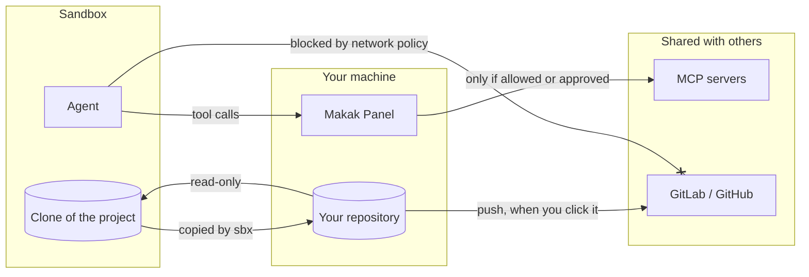
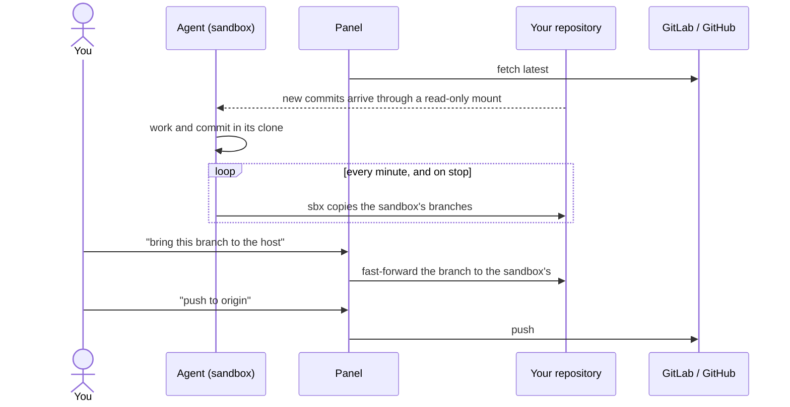
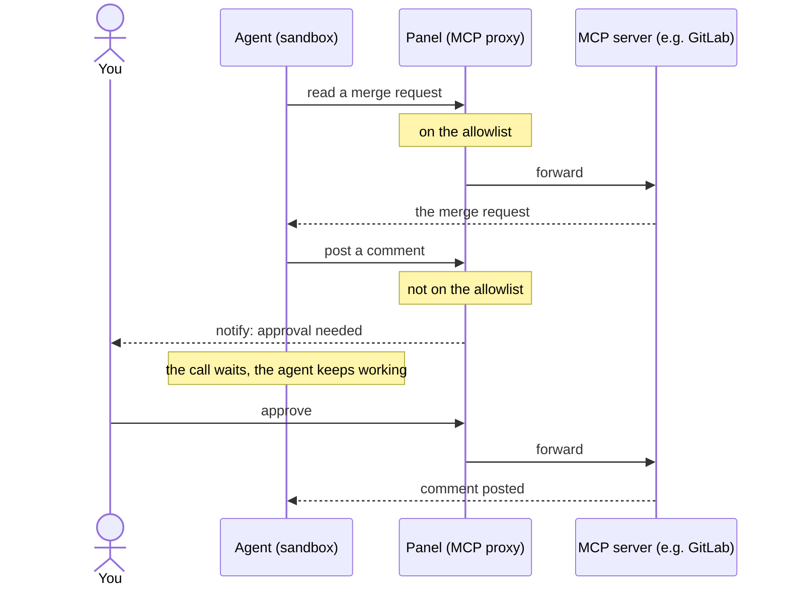
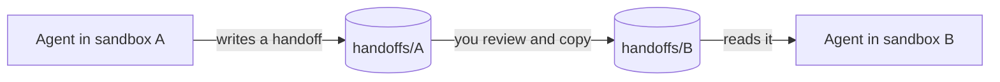

# The Makak Workflow

A way of working with AI coding agents that lets them work freely, without ever letting them act on your behalf where other people can see it.

## The idea in two rules

1. **Inside its sandbox, an agent can do anything.** It can edit, build, run tests, commit, rebase, or make a mess. Nothing it does there can hurt you, because nothing there is shared.
2. **Anything other people can see goes through you.** Pushing code, commenting on a merge request, posting to Slack: each one needs your explicit approval.

The rest of this document explains how those two rules are kept, and what a day of work looks like under them.

## The pieces

| Piece | What it is |
| --- | --- |
| **Sandbox** | An isolated Docker Sandbox (`sbx`) running one agent on one task. |
| **Host** | Your own machine, with your real repositories. |
| **Origin** | The shared Git hosting: GitLab or GitHub. |
| **MCP servers** | Services the agent uses to read issues, merge requests and so on. |
| **Panel** | Makak Panel, a local web app where you see and control all of the above. |
| **Handoffs** | A folder per sandbox for documents that agents write for each other. |

Each sandbox works on a **clone** of your project, not on the project itself. The agent can rewrite its clone freely, and your real repository stays untouched until you decide to take its work.

## Where the walls are

An agent could reach the outside world through two channels: the network, and MCP tool calls. Each is closed separately, because neither can see the other.

- **Network.** The sandbox's network policy blocks the forge entirely. The agent cannot `git push`, call the API, or `curl` its way out, even if it has a token.
- **MCP.** Tool calls don't go through the network policy at all. They travel through the Panel's MCP proxy instead. Tools that only read run straight through, and anything else waits until you approve it.

A few more settings keep the walls intact:

- Other projects you mount for reference are always **read-only**. A writable mount would bypass the clone entirely.
- The agent can't add MCP servers for itself.
- The agent can't reach the Panel, so it can't ask the Panel to act for it.
- MCP servers get read-only tokens where possible, so a mistake in the allowlist can't turn into a published comment.

These rules live in the sandbox configuration, not in the Panel. They hold even if you never open the Panel and work straight from a terminal.

## How code flows

The sandbox never pushes anywhere. Work moves outward only when something on the host _pulls_ it, and the final step to origin is always yours.

Things to know:

- **The sandbox only sees origin through your machine.** To give an agent the latest `main`, fetch it on the host first (the Panel has a button for this).
- **Stopping or removing a sandbox loses no commits.** sbx keeps a copy of every sandbox branch in your repository, under `refs/sandboxes/<sandbox>/`, so you can see and take them while the sandbox is stopped, and after it is gone. Before removing one, the Panel lists the commits that are only in that copy, on no branch of yours.

## How tool calls are approved

If you deny a call instead, the agent gets a refusal and nothing reaches the server.

Every request shows what exactly the agent wants to send, such as the full text of a comment. It doesn't show which sandbox is asking: sbx doesn't say, and the content usually does. You can **allow once**, or **always allow** a tool you trust. The allowlist grows as you go: approvals are frequent at first, and become rare once the read-only tools are confirmed.

## Working across projects

Sometimes a task in one project needs a change in another. Agents don't talk to each other directly. They leave documents, and you carry them across.

- Each sandbox has its own handoff folder, which lives on your machine and survives the sandbox's removal.
- There is no shared folder on purpose. You are always the one carrying a document between agents, so you see it before the next agent acts on it.
- Handoffs are only ever read. Nothing on your machine runs anything from them.

## A typical task

1. **Start a sandbox.** In the Panel, choose the project to work on, any other projects to mount read-only, and the MCP servers you'll need.
2. **Work.** Prompt the agent from the Panel, a terminal or VS Code over SSH. Run the app and open it at its stable URL, e.g. `https://feature-a.makak.test:8000`.
3. **Review.** When the code looks right, bring the branch to your host and push it to origin from the Panel.
4. **Open a merge request.** Ask the agent to prepare one. Its MCP call waits in the Panel until you've read it and approved it.
5. **Leave a note.** Record in the Panel where the work stands, so you can pick it up later.
6. **Need a change elsewhere?** Ask the agent for a handoff document, start a sandbox for the other project, copy the document over, and continue there.
7. **Clean up.** Remove the sandbox when you're done. The Panel makes sure no work is lost.

## What the Panel will and won't stop you doing

The Panel is a helper, not a guard. The guarantees come from the sandbox configuration described above.

- **Workflow deviations** get a warning and are never blocked. Examples: a writable extra mount, or a sandbox that can reach the forge.
- **Possible data loss** always needs a confirmation that lists exactly what would be lost. Losing commits is bad whatever workflow you follow.
